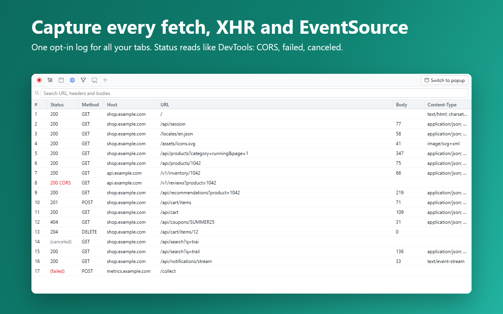
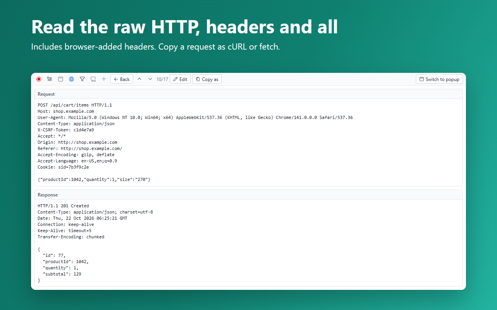
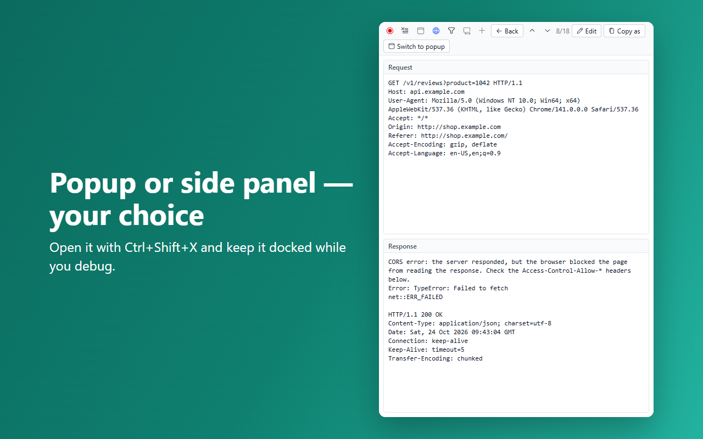
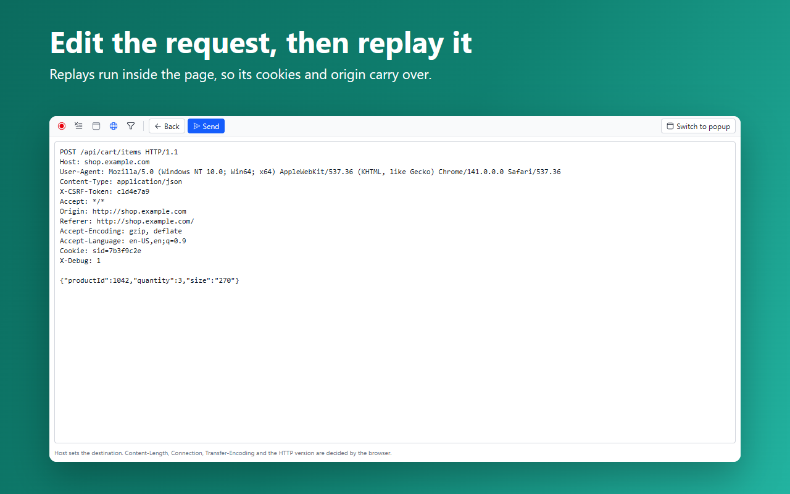
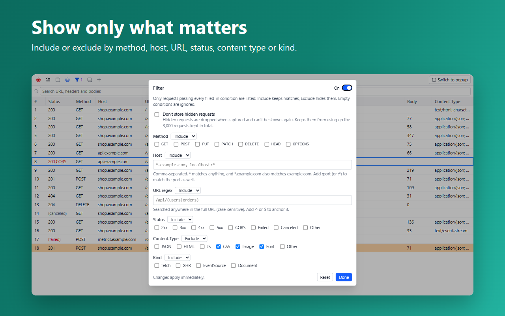

[English](README.md) | **한국어**

# ReFetch

ReFetch는 Chrome과 Firefox용 브라우저 확장 프로그램입니다. 여러 탭의 fetch, XHR, EventSource 요청을 캡처해 원문 HTTP로 보여 주고, 수정해서 요청을 보낸 페이지에서 다시 보낼 수 있습니다.

- [Chrome 웹스토어에서 설치](https://chromewebstore.google.com/detail/refetch/aobjmhncnmbideoghphkpjpehmbfohfe)
- [변경 내역 (영문)](CHANGELOG.md)
- [개인정보 처리방침 (영문)](PRIVACY.md)

## 주요 기능

- 스위치 하나로 모든 탭을 캡처하며, 기본으로 꺼져 있습니다. Status는 개발자도구처럼 `200 CORS`, `(failed)`, `(canceled)`로 표시합니다.
- 모든 탭의 요청을 최근 3,000건까지 하나의 기록으로 모읍니다. 페이지를 이동해도, 탭을 닫아도 남아 있습니다. This tab only를 켜면 현재 탭의 요청만 봅니다.
- 브라우저가 추가한 쿠키 등 헤더까지 포함한 원문 요청·응답. 이전·다음 버튼으로 요청을 넘겨 봅니다.
- 원래 페이지에서 수정 후 재전송하므로 그 페이지의 쿠키와 origin이 그대로 적용됩니다. 그 페이지가 사라졌다면 확장 프로그램에서 대신 보낼 수 있습니다.
- 메서드, 호스트, URL, Status, Content-Type, Kind별 Include/Exclude 필터.
- 페이지 이동 요청 캡처, 요청을 보낸 탭을 보여 주는 Tab 컬럼, 팝업 또는 사이드 패널.
- 데이터는 브라우저 밖으로 나가지 않습니다. 서버도 분석 도구도 없습니다.

## 시작하기

1. 확인할 페이지를 열고 툴바의 ReFetch 아이콘을 누릅니다. 단축키는 `Ctrl+Shift+X`(macOS는 `Command+Shift+X`)입니다.
2. 사이트 접근 권한을 요청하면 허용한 뒤 페이지를 새로고침합니다.
3. 녹화 버튼(●)을 눌러 캡처를 시작합니다. 캡처는 기본으로 꺼져 있고, 한 번 누르면 끄거나 브라우저를 다시 시작할 때까지 모든 탭에서 켜집니다.
4. 평소처럼 페이지를 사용하면, 모든 탭에서 완료된 요청이 목록에 쌓입니다. **This tab only**를 켜면 현재 탭의 요청만 보입니다.

## 요청 살펴보기

- 행을 누르면 요청과 응답을 원문으로 볼 수 있습니다. 브라우저가 추가한 헤더(쿠키 등)도 함께 표시되고, 스트리밍 응답은 들어오는 대로 갱신됩니다.
- **Back** 옆의 위/아래 버튼으로 이전·다음 요청으로 이동합니다.
- **Status** 컬럼은 개발자도구와 같은 방식으로 표시합니다. `200 CORS`는 서버는 응답했지만 CORS 때문에 페이지가 응답을 읽지 못한 경우, `(failed)`는 네트워크 오류, `(canceled)`는 중단된 요청입니다. 마우스를 올리면 자세한 내용이 보입니다.
- 목록 헤더를 우클릭하면 컬럼을 보이거나 숨기고, 요청·응답 헤더 컬럼과 요청을 보낸 탭의 ID를 보여 주는 **Tab** 컬럼을 추가할 수 있습니다. 헤더를 끌어 순서를 바꾸고, 가장자리를 끌어 너비를 조절합니다.

## 수정 후 재전송

1. 요청을 열고 **Edit**을 누릅니다.
2. 원문 요청의 메서드, URL, 헤더, 본문을 고칩니다.
3. **Send**를 누르면 원래 페이지에서 다시 보내므로 그 페이지의 쿠키와 origin이 그대로 적용됩니다. `Cookie`, `User-Agent`처럼 페이지가 직접 설정할 수 없는 헤더는 그 요청에만 적용됩니다.

재전송한 요청은 목록에서 주황색으로 표시됩니다.

요청을 보낸 페이지가 사라졌다면(탭을 닫았거나 프레임이 다른 origin으로 이동한 경우) **Send from extension**을 누를 수 있습니다. 이때는 확장 프로그램이 수정한 요청을 직접 보냅니다. 그 페이지의 CORS, 쿠키 정책, Origin이 적용되지 않고, 편집기에 보이는 헤더는 `Cookie`까지 그대로 전송됩니다. `Cookie` 줄을 지우면 쿠키를 보내지 않으며, 처음부터 `Cookie` 줄이 없던 요청에만 브라우저의 일반 쿠키가 붙습니다. 직접 고르지 않으면 이 방식으로 보내지 않으며, 이렇게 보낸 요청에는 "Sent from extension"이 표시됩니다.

## 필터

깔때기 아이콘을 눌러 필터를 엽니다.

- 메서드, 호스트(`*.example.com, localhost:*`), URL 정규식, Status, Content-Type, Kind 조건을 걸 수 있습니다. 조건마다 **Include**(포함) 또는 **Exclude**(제외)를 고르고, 비워 둔 조건은 무시됩니다.
- 조건에 맞지 않는 요청은 목록에서 숨겨지고, 숨긴 건수가 툴바에 표시됩니다.
- **Don't store hidden requests**를 켜면 숨겨질 요청을 캡처 단계에서 아예 저장하지 않습니다. 나중에 다시 볼 수는 없지만, 전체 3,000건 보관 한도를 차지하지 않습니다.

## 툴바

| 버튼 | 기능 |
| --- | --- |
| ● 녹화 | 모든 탭의 캡처 시작·중지 |
| Clear | 캡처한 요청을 모두 삭제. This tab only가 켜져 있어도 다른 탭의 요청까지 지웁니다 |
| This tab only | 현재 탭의 요청만 표시 |
| 지구본 (Document requests) | 페이지 이동과 리다이렉트 요청도 캡처 |
| 깔때기 (Filter) | 필터 열기 |
| Open as panel / Switch to popup | 사이드 패널(Firefox는 사이드바) 또는 팝업으로 전환 |

캡처한 요청은 브라우저 안에만 저장되고, Clear를 누르거나 브라우저를 다시 시작할 때까지 남아 있습니다. 페이지를 이동하거나 새로고침하거나 탭을 닫아도 지워지지 않습니다. 시크릿/비공개 창에서도 확장 프로그램을 허용했다면 같은 기록을 함께 씁니다. 자세한 내용은 [개인정보 처리방침](PRIVACY.md)을 참고하세요.
